# Precision Slate ERP — Proposed MySQL ERD v2

**UNAPPROVED — review artifact only.** This map describes
[`precision_slate_proposed_mysql_v2.sql`](./precision_slate_proposed_mysql_v2.sql).
No SQL has been executed. D1–D10 and other unresolved business policies remain
open. The map lists every table and every foreign-key table relationship in
the DDL; composite keys and service-only invariants are called out below.

```mermaid
erDiagram
    CURRENCIES ||--o{ CUSTOMERS : credit_limit_currency
    CURRENCIES ||--o{ PRODUCTS : price_currency
    CURRENCIES ||--o{ SALES_DOCUMENTS : currency
    CURRENCIES ||--o{ SALES_RECEIPTS : currency
    CURRENCIES ||--o{ TREASURY_ACCOUNTS : currency
    CURRENCIES ||--o{ TREASURY_ENTRIES : currency
    CURRENCIES ||--o{ JOURNAL_ENTRIES : currency
    CURRENCIES ||--o{ JOURNAL_LINES : currency
    CURRENCIES ||--o{ CONTAINERS : currency
    CURRENCIES ||--o{ CONTAINER_LINES : cost_currency
    CURRENCIES ||--o{ CONTAINER_COSTS : currency
    CURRENCIES ||--o{ CONTAINER_COST_ALLOCATIONS : allocation_currency
    CURRENCIES ||--o{ CONTAINER_COST_PAYMENTS : payment_currency
    CURRENCIES ||--o{ SALES_ORDERS : currency
    CURRENCIES ||--o{ TREASURY_TRANSFERS : transfer_currency
    CURRENCIES ||--o{ INVENTORY_MOVEMENT_LINES : cost_currency
    CURRENCIES ||--o{ EXPENSES : currency

    USERS ||--o{ USER_ROLES : assigned
    ROLES ||--o{ USER_ROLES : granted
    ROLES ||--o{ ROLE_PERMISSIONS : contains
    PERMISSIONS ||--o{ ROLE_PERMISSIONS : assigned
    USERS ||--o{ AUTH_SESSIONS : authenticates
    USERS ||--o{ PASSWORD_RESET_TOKENS : resets
    USERS ||--o{ CUSTOMERS : creates_or_updates
    USERS ||--o{ PRODUCTS : creates_or_updates
    USERS ||--o{ SALES_DOCUMENTS : creates_posts_or_reverses
    USERS ||--o{ SALES_RECEIPTS : creates_or_posts
    USERS ||--o{ JOURNAL_ENTRIES : creates_or_posts
    USERS ||--o{ TREASURY_ENTRIES : creates
    USERS ||--o{ EXPENSES : creates_or_posts
    USERS ||--o{ TREASURY_TRANSFERS : creates_or_posts
    USERS ||--o{ INVENTORY_MOVEMENTS : creates_or_posts
    USERS ||--o{ CONTAINERS : creates_or_receives
    USERS ||--o{ CONTAINER_RECEIPTS : receives
    USERS ||--o{ CONTAINER_RECEIPT_LINES : records_discrepancy
    USERS ||--o{ CONTAINER_COSTS : creates
    USERS ||--o{ CONTAINER_COST_PAYMENTS : pays
    USERS ||--o{ SALES_ORDERS : creates_or_confirms
    USERS ||--o{ DELIVERIES : creates_or_drives
    USERS ||--o{ SALES_RECEIPT_ALLOCATION_REVERSALS : reverses_allocation
    USERS ||--o{ ATTACHMENT_METADATA : uploads
    USERS ||--o{ AUDIT_LOGS : acts
    USERS ||--o{ IDEMPOTENCY_RECORDS : submits
    USERS ||--o{ APP_SETTINGS : updates

    PRODUCT_CATEGORIES o|--o{ PRODUCT_CATEGORIES : parent
    PRODUCT_CATEGORIES o|--o{ PRODUCTS : classifies
    LOCATIONS o|--o{ LOCATIONS : parent
    CUSTOMERS ||--o{ SALES_DOCUMENTS : billed
    SALES_DOCUMENTS o|--o{ SALES_DOCUMENTS : original_or_reversal
    JOURNAL_ENTRIES o|--o| JOURNAL_ENTRIES : reversal
    TREASURY_ENTRIES o|--o| TREASURY_ENTRIES : reversal
    SALES_RECEIPTS o|--o| SALES_RECEIPTS : reversal
    SALES_DOCUMENTS ||--|{ SALES_DOCUMENT_LINES : contains
    PRODUCTS ||--o{ SALES_DOCUMENT_LINES : sold_or_returned
    LOCATIONS o|--o{ SALES_DOCUMENT_LINES : fulfills
    SALES_DOCUMENT_LINES o|--o{ SALES_DOCUMENT_LINES : returned_from

    CUSTOMERS ||--o{ SALES_RECEIPTS : pays_or_refunds
    TREASURY_ACCOUNTS ||--o{ SALES_RECEIPTS : received_into
    SALES_RECEIPTS ||--o{ SALES_RECEIPT_ALLOCATIONS : allocates
    SALES_DOCUMENTS ||--o{ SALES_RECEIPT_ALLOCATIONS : settled_by
    SALES_RECEIPT_ALLOCATIONS ||--o{ SALES_RECEIPT_ALLOCATION_REVERSALS : reversal_history
    SALES_RECEIPTS ||--o| SALES_RECEIPT_POSTINGS : posted_effects
    TREASURY_ENTRIES o|--o| SALES_RECEIPT_POSTINGS : cash_effect
    JOURNAL_ENTRIES o|--o| SALES_RECEIPT_POSTINGS : journal_effect

    TREASURY_ACCOUNTS ||--o{ TREASURY_ENTRIES : ledger
    TREASURY_ACCOUNTS ||--o{ TREASURY_TRANSFERS : source_or_destination
    TREASURY_TRANSFERS ||--o{ TREASURY_TRANSFER_ENTRIES : paired_legs
    TREASURY_ENTRIES ||--o| TREASURY_TRANSFER_ENTRIES : used_once_as_leg
    CHART_OF_ACCOUNTS o|--o{ CHART_OF_ACCOUNTS : parent
    JOURNAL_ENTRIES ||--|{ JOURNAL_LINES : contains
    CHART_OF_ACCOUNTS ||--o{ JOURNAL_LINES : posted_to
    CUSTOMERS o|--o{ JOURNAL_LINES : subledger_dimension
    SUPPLIERS o|--o{ JOURNAL_LINES : subledger_dimension
    TREASURY_ACCOUNTS o|--o{ JOURNAL_LINES : subledger_dimension
    TREASURY_ACCOUNTS ||--o{ EXPENSES : paid_from
    CHART_OF_ACCOUNTS o|--o{ EXPENSES : categorized_as
    TREASURY_ENTRIES o|--o| EXPENSES : cash_effect
    JOURNAL_ENTRIES o|--o| EXPENSES : accounting_effect
    JOURNAL_ENTRIES o|--o| TREASURY_TRANSFERS : accounting_effect

    INVENTORY_MOVEMENTS ||--|{ INVENTORY_MOVEMENT_LINES : contains
    PRODUCTS ||--o{ INVENTORY_MOVEMENT_LINES : moved
    LOCATIONS o|--o{ INVENTORY_MOVEMENT_LINES : from_or_to
    SALES_DOCUMENT_LINES o|--o{ INVENTORY_MOVEMENT_LINES : sale_or_return_source
    INVENTORY_MOVEMENT_LINES o|--o{ INVENTORY_MOVEMENT_LINES : reversed_by
    PRODUCTS ||--o{ INVENTORY_BALANCES : balance_projection
    LOCATIONS ||--o{ INVENTORY_BALANCES : balance_projection
    INVENTORY_MOVEMENTS o|--o| INVENTORY_MOVEMENTS : reversal
    SALES_DOCUMENTS ||--o| SALES_DOCUMENT_POSTINGS : posted_effects
    INVENTORY_MOVEMENTS o|--o| SALES_DOCUMENT_POSTINGS : stock_effect
    JOURNAL_ENTRIES o|--o| SALES_DOCUMENT_POSTINGS : journal_effect

    SUPPLIERS o|--o{ CONTAINERS : supplied
    LOCATIONS o|--o{ CONTAINERS : received_at
    CONTAINERS ||--|{ CONTAINER_LINES : contains
    PRODUCTS ||--o{ CONTAINER_LINES : ordered
    CONTAINERS ||--o{ CONTAINER_COSTS : incurs
    SUPPLIERS o|--o{ CONTAINER_COSTS : invoices_cost
    CONTAINER_COSTS ||--o{ CONTAINER_COST_ALLOCATIONS : distributed
    CONTAINER_RECEIPT_LINES ||--o{ CONTAINER_COST_ALLOCATIONS : receives_cost
    CONTAINERS ||--o{ CONTAINER_RECEIPTS : receipt_events
    INVENTORY_MOVEMENTS ||--o| CONTAINER_RECEIPTS : posts_stock
    JOURNAL_ENTRIES o|--o| CONTAINER_RECEIPTS : accounting_effect
    CONTAINER_RECEIPTS ||--|{ CONTAINER_RECEIPT_LINES : records_lines
    CONTAINER_LINES ||--o{ CONTAINER_RECEIPT_LINES : actuals_for
    CONTAINER_RECEIPT_LINES o|--o| INVENTORY_MOVEMENT_LINES : stock_effect
    CONTAINER_COSTS ||--o{ CONTAINER_COST_PAYMENTS : paid_in_parts
    TREASURY_ENTRIES ||--o| CONTAINER_COST_PAYMENTS : cash_effect
    JOURNAL_ENTRIES o|--o| CONTAINER_COST_PAYMENTS : accounting_effect

    CUSTOMERS ||--o{ SALES_ORDERS : places
    SALES_ORDERS ||--|{ SALES_ORDER_LINES : contains
    PRODUCTS ||--o{ SALES_ORDER_LINES : ordered
    SALES_ORDER_LINES ||--o{ SALES_ORDER_INVOICE_ALLOCATIONS : invoiced_qty
    SALES_DOCUMENT_LINES ||--o{ SALES_ORDER_INVOICE_ALLOCATIONS : invoice_qty
    SALES_ORDERS o|--o{ DELIVERIES : fulfilled_by
    SALES_DOCUMENTS o|--o{ DELIVERIES : invoiced_delivery
    DELIVERIES ||--|{ DELIVERY_LINES : contains
    SALES_ORDER_LINES o|--o{ DELIVERY_LINES : fulfills_order_line
    SALES_DOCUMENT_LINES o|--o{ DELIVERY_LINES : fulfills_invoice_line
    PRODUCTS ||--o{ DELIVERY_LINES : delivered
    INVENTORY_MOVEMENT_LINES ||--o| DELIVERY_LINES : stock_issue

    DOCUMENT_SEQUENCES {
        bigint id PK
        varchar sequence_key UK
        varchar period_key UK
        bigint next_number
    }
    AUDIT_LOGS {
        bigint id PK
        bigint actor_user_id FK
        varchar entity_type
        bigint entity_id
        json before_data
        json after_data
    }
    IDEMPOTENCY_RECORDS {
        bigint id PK
        bigint user_id FK
        varchar idempotency_key UK
        binary request_hash
        json response_body
    }
    APP_SETTINGS {
        varchar setting_key PK
        json setting_value
        bigint updated_by_user_id FK
    }
    ATTACHMENT_METADATA {
        bigint id PK
        varchar storage_key UK
        varchar original_filename
        bigint byte_size
        binary sha256
        bigint uploaded_by_user_id FK
    }
```

## Structural guarantees and limits

- A container has many receipt-event headers. Each receipt event references one
  stock movement; its receipt lines reference container lines through a
  composite `(container_id, container_line_id, product_id)` foreign key.
  Inventory movement lines reference the receipt line, movement header, and
  product as one composite FK. These constraints enforce the same container,
  receipt movement, and product.
- `container_receipt_lines` stores expected/received/discrepancy quantities,
  reason, condition label, actor, and timestamp. The discrepancy is constrained
  to `received_quantity - expected_quantity`. It does not prescribe acceptance,
  over-receipt, or disposition policy.
- `sales_order_invoice_allocations` stores partial quantities and uses composite
  product keys on both source lines. `delivery_lines` require exactly one order
  or invoice line and one linked stock movement line of the same product.
- `container_cost_allocations` has composite FKs through the same `container_id`
  to both `container_costs` and `container_receipt_lines`, preventing allocation
  of a cost from one container to another container's receipt.
- Typed posting bridges and unique source keys prevent multiple linked effects
  for the same document/receipt/cost/transfer leg where modeled. Aggregate
  balances, posted-state eligibility, and cross-document scope still require
  transaction-service validation.
- `inventory_balances` is a rebuildable projection. **Negative-stock policy is
  OPEN**; no nonnegative check is imposed on `quantity_on_hand`.
- Journal debit/credit balance is a posting-service rule, not a DDL check.
- `attachment_metadata` is optional and **pending G-06**. It stores metadata
  only; bytes, owner links, storage security, scanning, retention, and access
  policy are not decided.
- Reports remain derived; this proposal adds no report snapshot tables.
