# Precision Slate ERP — Proposed MySQL ERD

**Status: proposal for review only.** This diagram describes the accompanying
[`precision_slate_proposed_mysql.sql`](./precision_slate_proposed_mysql.sql).
It is not an approved schema and has not been executed. Cardinalities show
database relationships; additional conditional rules are described in the
design notes.

```mermaid
erDiagram
    CURRENCIES o|--o{ PRODUCTS : prices
    CURRENCIES o|--o{ CUSTOMERS : credit_limit
    CURRENCIES ||--o{ SALES_DOCUMENTS : denominates
    CURRENCIES ||--o{ SALES_RECEIPTS : denominates
    CURRENCIES ||--o{ TREASURY_ACCOUNTS : denominates
    CURRENCIES ||--o{ TREASURY_ENTRIES : denominates
    CURRENCIES ||--o{ JOURNAL_ENTRIES : denominates
    CURRENCIES ||--o{ JOURNAL_LINES : denominates
    CURRENCIES o|--o{ CONTAINERS : purchase_currency
    CURRENCIES o|--o{ CONTAINER_LINES : purchase_cost
    CURRENCIES ||--o{ CONTAINER_COSTS : cost_currency
    CURRENCIES ||--o{ CONTAINER_COST_ALLOCATIONS : allocation_currency
    CURRENCIES ||--o{ SALES_ORDERS : denominates
    CURRENCIES ||--o{ TREASURY_TRANSFERS : transfer_currency

    USERS ||--o{ USER_ROLES : assigned
    ROLES ||--o{ USER_ROLES : grants
    ROLES ||--o{ ROLE_PERMISSIONS : contains
    PERMISSIONS ||--o{ ROLE_PERMISSIONS : assigned
    USERS ||--o{ AUTH_SESSIONS : authenticates
    USERS ||--o{ PASSWORD_RESET_TOKENS : resets

    PRODUCT_CATEGORIES o|--o{ PRODUCT_CATEGORIES : parent
    PRODUCT_CATEGORIES o|--o{ PRODUCTS : classifies
    LOCATIONS o|--o{ LOCATIONS : parent
    CUSTOMERS ||--o{ SALES_DOCUMENTS : billed
    SALES_DOCUMENTS o|--o{ SALES_DOCUMENTS : original_or_reversal
    SALES_DOCUMENTS ||--|{ SALES_DOCUMENT_LINES : contains
    PRODUCTS ||--o{ SALES_DOCUMENT_LINES : sold_or_returned
    LOCATIONS o|--o{ SALES_DOCUMENT_LINES : fulfills
    SALES_DOCUMENT_LINES o|--o{ SALES_DOCUMENT_LINES : returned_from

    CUSTOMERS ||--o{ SALES_RECEIPTS : pays_or_refunds
    TREASURY_ACCOUNTS ||--o{ SALES_RECEIPTS : receives
    SALES_RECEIPTS ||--o{ SALES_RECEIPT_ALLOCATIONS : allocates
    SALES_DOCUMENTS ||--o{ SALES_RECEIPT_ALLOCATIONS : settled_by

    TREASURY_ACCOUNTS ||--o{ TREASURY_ENTRIES : records
    TREASURY_ACCOUNTS ||--o{ TREASURY_TRANSFERS : source_or_destination
    CHART_OF_ACCOUNTS o|--o{ CHART_OF_ACCOUNTS : parent
    JOURNAL_ENTRIES ||--|{ JOURNAL_LINES : contains
    CHART_OF_ACCOUNTS ||--o{ JOURNAL_LINES : posted_to
    CUSTOMERS o|--o{ JOURNAL_LINES : subledger_dimension
    SUPPLIERS o|--o{ JOURNAL_LINES : subledger_dimension
    TREASURY_ACCOUNTS o|--o{ JOURNAL_LINES : subledger_dimension
    TREASURY_ACCOUNTS ||--o{ EXPENSES : paid_from
    CHART_OF_ACCOUNTS o|--o{ EXPENSES : categorized_as
    TREASURY_ENTRIES o|--o| EXPENSES : cash_effect
    JOURNAL_ENTRIES o|--o| EXPENSES : accounting_effect
    TREASURY_ENTRIES o|--o| TREASURY_TRANSFERS : transfer_leg
    JOURNAL_ENTRIES o|--o| TREASURY_TRANSFERS : accounting_effect

    INVENTORY_MOVEMENTS ||--|{ INVENTORY_MOVEMENT_LINES : contains
    PRODUCTS ||--o{ INVENTORY_MOVEMENT_LINES : moved
    LOCATIONS o|--o{ INVENTORY_MOVEMENT_LINES : from_location
    LOCATIONS o|--o{ INVENTORY_MOVEMENT_LINES : to_location
    SALES_DOCUMENT_LINES o|--o{ INVENTORY_MOVEMENT_LINES : sale_return_source
    PRODUCTS ||--o{ INVENTORY_BALANCES : balance_projection
    LOCATIONS ||--o{ INVENTORY_BALANCES : balance_projection
    INVENTORY_MOVEMENTS o|--o| INVENTORY_MOVEMENTS : reversal

    SUPPLIERS o|--o{ CONTAINERS : supplied
    LOCATIONS o|--o{ CONTAINERS : received_at
    CONTAINERS ||--|{ CONTAINER_LINES : contains
    PRODUCTS ||--o{ CONTAINER_LINES : ordered
    CONTAINERS ||--o{ CONTAINER_COSTS : incurs
    SUPPLIERS o|--o{ CONTAINER_COSTS : invoices_cost
    TREASURY_ENTRIES o|--o{ CONTAINER_COSTS : paid_by
    CONTAINER_COSTS ||--o{ CONTAINER_COST_ALLOCATIONS : distributed
    CONTAINER_LINES ||--o{ CONTAINER_COST_ALLOCATIONS : receives_cost
    CONTAINERS ||--o| CONTAINER_RECEIPTS : received_once
    INVENTORY_MOVEMENTS ||--o| CONTAINER_RECEIPTS : posts_stock

    CUSTOMERS ||--o{ SALES_ORDERS : places
    SALES_ORDERS ||--|{ SALES_ORDER_LINES : contains
    PRODUCTS ||--o{ SALES_ORDER_LINES : ordered
    SALES_ORDERS o|--o{ DELIVERIES : fulfilled_by
    SALES_DOCUMENTS o|--o{ DELIVERIES : invoiced_delivery
    DELIVERIES ||--|{ DELIVERY_LINES : contains
    SALES_ORDER_LINES o|--o{ DELIVERY_LINES : fulfills_order_line
    SALES_DOCUMENT_LINES o|--o{ DELIVERY_LINES : fulfills_invoice_line
    PRODUCTS ||--o{ DELIVERY_LINES : delivered

    USERS o|--o{ AUDIT_LOGS : acts
    USERS o|--o{ IDEMPOTENCY_RECORDS : submits
    USERS o|--o{ APP_SETTINGS : updates
    DOCUMENT_SEQUENCES {
        bigint id PK
        varchar sequence_key UK
        varchar period_key UK
        bigint next_number
    }
    AUDIT_LOGS {
        bigint id PK
        bigint actor_user_id FK
        varchar entity_type
        bigint entity_id
        json before_data
        json after_data
    }
    IDEMPOTENCY_RECORDS {
        bigint id PK
        bigint user_id FK
        varchar idempotency_key UK
        binary request_hash
        json response_body
    }
    APP_SETTINGS {
        varchar setting_key PK
        json setting_value
        bigint updated_by_user_id FK
    }
```

## Relationship notes

- `inventory_balances` is a lockable/query-friendly **projection**, keyed by
  `(product_id, location_id)`. Posted `inventory_movement_lines` remain the
  auditable source of stock history; reconciliation must recompute the
  projection.
- `sales_documents` represents invoices and credit notes/returns. A return
  line can reference the originating invoice line. Service validation must
  enforce document type, customer, returnable quantity, and return policy.
- Receipt allocations connect customer receipts/refunds to sales documents.
  The database foreign keys ensure existence, but not that customer, currency,
  document type, status, and aggregate allocated totals are compatible.
- Journal and treasury source references are intentionally polymorphic in
  places (`source_type`, `source_id`) because final workflows and journal
  templates are not approved. They require service validation and audit.
- `container_receipts` has one row per container and a unique key to provide a
  final duplicate-receipt guard. Receipt, stock movements, cost allocations,
  journals (when approved), and audit must still be one transaction.
- Orders and deliveries are included to represent existing prototype screens,
  but their implementation remains gated by the unresolved D8 scope decision.
- `suppliers` is included to associate container costs with counterparties.
  Supplier invoices/payables are **not** modeled because supplier/AP scope is
  still conditional on D9.
